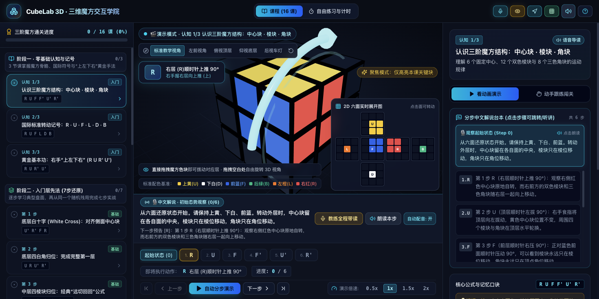
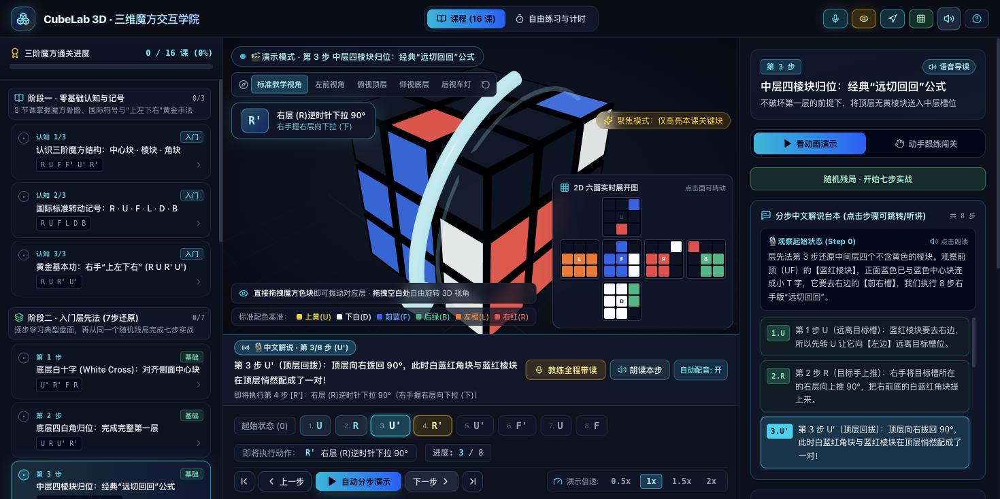
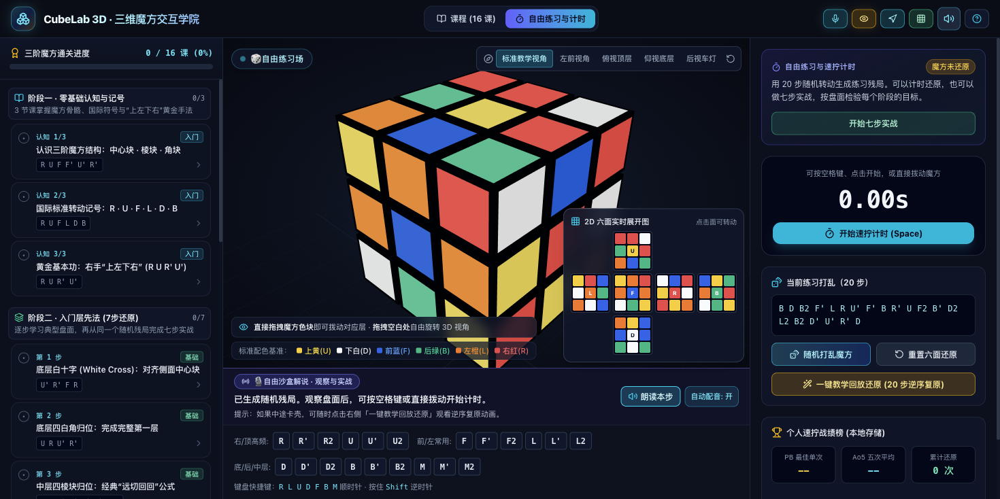
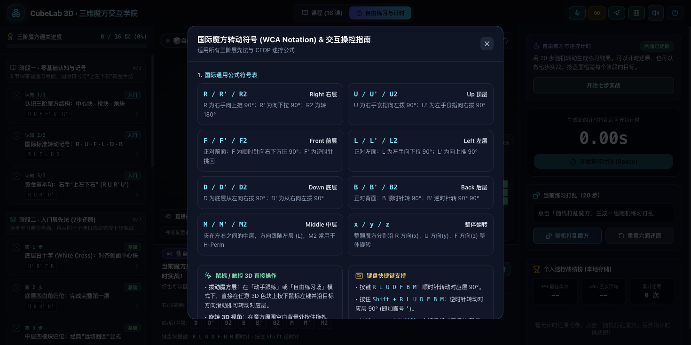

<div align="center">
  
  <h1>CubeLab 3D · 三维魔方沉浸式交互学院</h1>
  <p>从零基础层先法 (LBL) 到 CFOP 速拧的 3D 交互式魔方教学与训练应用</p>

  <p>
    <a href="https://github.com/ChingYung717/rubiks-cube-academy/actions/workflows/ci.yml">
      
    </a>
    <a href="https://github.com/ChingYung717/rubiks-cube-academy/actions/workflows/deploy.yml">
      
    </a>
    <a href="LICENSE">
      
    </a>
  </p>

  <p>
    <strong>🎮 <a href="https://chingyung717.github.io/rubiks-cube-academy/">在线体验 (GitHub Pages)</a></strong>
  </p>
</div>

---



## ✨ 核心特性

- **🧊 3D 沉浸式魔方舞台（Three.js）**
  - 支持鼠标/触控直接拖拽魔方色块拨动对应层，或拖拽空白处 360° 自由旋转观察视角
  - 内置 5 组教学预设视角（标准教学视角、左前视角、俯视顶层、仰视底层、后视车灯）
  - **目标块聚焦模式**：暗化无关块，仅高亮当前课程需要观察与归位的关键棱块/角块
  - **3D 空间提示箭头**：实时生成弧形发光箭头与活动层高亮光环，直观指引下一步转动方向
- **🗺️ 2D 六面实时展开图**
  - 54 色块平面展开图与 3D 魔方完全同步，支持直接在展开图上点击转动，兼顾背面的盲区观察
- **📚 3 大阶段 · 16 节体系化课程**
  - **阶段一 · 零基础认知与记号（3 课）**：中心块/棱块/角块结构、WCA 国际标准记号 (`R U F L D B`)、黄金基本功“上左下右” (`R U R' U'`)
  - **阶段二 · 入门层先法 7 步还原（7 课）**：底层白十字 → 底角归位 → 中层远切回回 → 顶层黄十字（含单点/拐角/横线三态切换）→ 小鱼公式 (Sune) → 车灯角块轮换 → 三棱换六面收官，并支持**同一随机残局 7 步连贯实战**
  - **阶段三 · CFOP 速拧进阶核心（6 课）**：盲拧级 Cross 底十字规划、F2L 标态角棱配对入槽、OLL #21 双车灯秒翻、PLL 之王 T-Perm 与极速 H-Perm
- **⏱️ 公式时间轴播放器 & 动手跟练闯关**
  - 支持分步前进/后退、任意步骤点击跳转、`0.5x ~ 2x` 倍速自动演示
  - **跟练闯关模式**：实时校验每一步拨动（含 `180°` 双转半圈提示与错步自动纠正指引）
- **🎙️ 同步中文解说 + 语音导读 (Web Speech API) + 机械拨动音效 (Web Audio API)**
  - 每一步操作均配有中文拆解台本、速记口诀与持握提示，支持教练全程语音带读
- **🏆 自由练习场与 WCA 速拧计时器**
  - 一键生成无冗余 20 步随机打乱，支持空格键速拧计时、一键 20 步逆序教学回放还原，自动统计个人最佳单次 (PB) 与五次去头尾平均 (Ao5) 并持久化至 `localStorage`

## 📸 界面预览

| 公式时间轴与目标块聚焦 | 自由打乱练习与速拧计时 | 国际标准符号与交互指南 |
| :---: | :---: | :---: |
|  |  |  |

## 🚀 快速开始

### 环境要求

- **Node.js** `>= 18`（推荐 `20+`）
- **npm** `>= 9`

### 安装与运行

```bash
# 1. 克隆仓库
git clone https://github.com/ChingYung717/rubiks-cube-academy.git
cd rubiks-cube-academy

# 2. 安装依赖
npm install

# 3. 启动本地开发服务器
npm run dev
```

### 常用脚本

```bash
npm test          # 运行 Vitest 魔方引擎与课程套件单元测试（19 项测试）
npm run build     # TypeScript 类型检查 + Vite 生产构建
npm run preview   # 本地预览生产构建产物
```

## 🗂️ 项目结构

```text
rubiks-cube-academy/
├── public/
│   └── cube-icon.svg                 # 应用图标
├── src/
│   ├── engine/
│   │   ├── cubeEngine.ts             # 三阶魔方数学模型、状态变换、打乱生成、跟练状态机与 Ao5 计算
│   │   └── __tests__/
│   │       └── cubeEngine.test.ts    # 魔方引擎与 16 节课程目标验证单元测试
│   ├── data/
│   │   └── curriculum.ts             # 3 大阶段 16 节课程配置、解说台本、黄十字三态与层先法 7 步里程碑判据
│   ├── components/
│   │   ├── Cube3DStage.tsx           # Three.js 3D 魔方渲染、射线拾取拖拽拨层、3D 提示箭头与相机预设
│   │   ├── Cube2DNet.tsx             # 54 贴纸 2D 六面同步展开图
│   │   ├── CurriculumSidebar.tsx     # 左侧课程目录与通关进度面板
│   │   ├── FormulaTimelinePlayer.tsx # 公式时间轴分步播放器与倍速控制
│   │   ├── LiveCommentaryBar.tsx     # 实时中文解说与语音控制栏
│   │   ├── RightWorkbenchPanel.tsx   # 右侧课程讲义、跟练闯关与自由速拧计时工作台
│   │   ├── NotationGuideModal.tsx    # WCA 国际魔方转动符号速查弹窗
│   │   └── TopNavbar.tsx             # 顶栏模式切换与视图/音效开关
│   ├── utils/
│   │   ├── narrationEngine.ts        # 中文 TTS 语音合成与魔方公式自然语言转写
│   │   ├── soundEngine.ts            # Web Audio API 合成魔方机械拨动与通关音效
│   │   └── storage.ts                # 课程通关进度与速拧战绩本地存储
│   ├── App.tsx                       # 主应用状态编排与键盘快捷键支持
│   ├── main.tsx                      # 应用入口
│   └── index.css                     # Tailwind CSS v4 全局样式
├── index.html
├── vite.config.ts
└── package.json
```

## 🛠️ 技术栈

- **前端框架**：React 18 + TypeScript 5.6
- **三维渲染**：Three.js (`0.170`)
- **样式方案**：Tailwind CSS v4 (`@tailwindcss/vite`) + Lucide Icons
- **构建与测试**：Vite 6 + Vitest 2

## 🤝 参与贡献

欢迎提交 Issue 或 Pull Request 来改进课程内容、补充更多 CFOP (F2L / OLL / PLL) 公式案例或优化 3D 交互体验！在提交 PR 前请确保通过测试与构建：

```bash
npm test && npm run build
```

## 📄 许可证

本项目基于 [MIT License](LICENSE) 开源，Copyright © 2026 [ChingYung717](https://github.com/ChingYung717)。

---

## 🌐 English Overview

**CubeLab 3D (`rubiks-cube-academy`)** is an interactive 3D Rubik's Cube learning and training web application built with **React 18**, **TypeScript**, **Three.js**, and **Tailwind CSS v4**.

- **Interactive 3D Stage & 2D Net**: Directly drag cube layers in 3D space, orbit the camera with 5 preset angles, highlight target cubies in Focus Mode, and follow real-time 3D directional arrows.
- **16 Structured Lessons**: Covers everything from 3×3 structure & WCA notation (`basics`), the 7-step Layer-by-Layer beginner method (`lbl`), to advanced speedcubing `CFOP` algorithms (Cross, F2L, OLL, PLL).
- **Step-by-Step Timeline & Guided Practice**: Scrub through formula moves, listen to synchronized Chinese voice commentary, or practice hands-on with real-time move validation and a WCA-style speedcubing timer (PB & Ao5 tracking).
